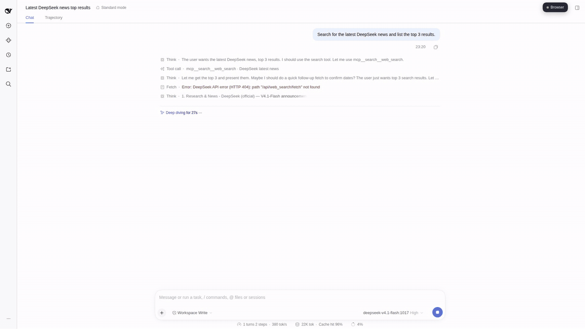
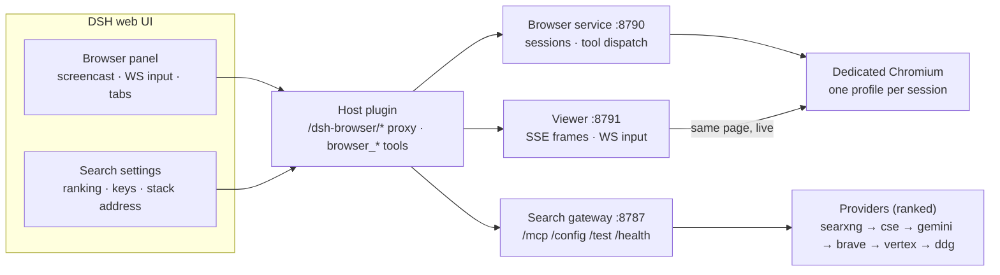
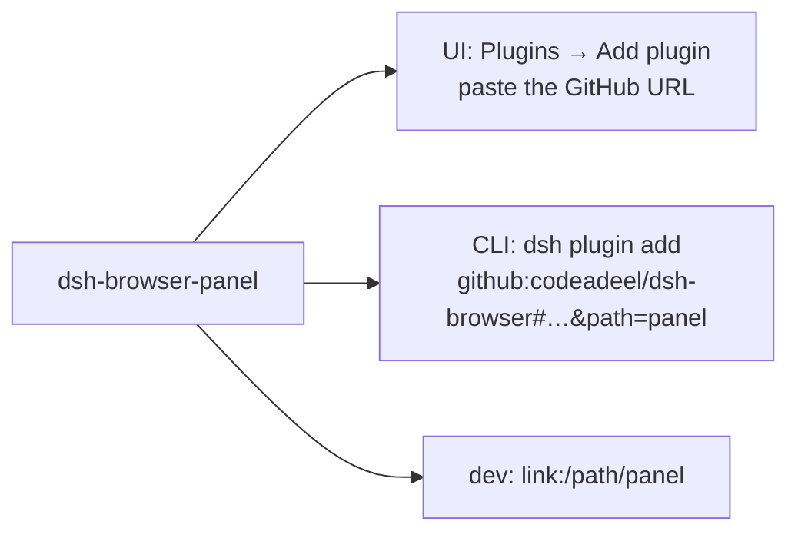
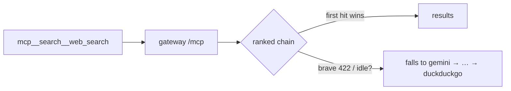
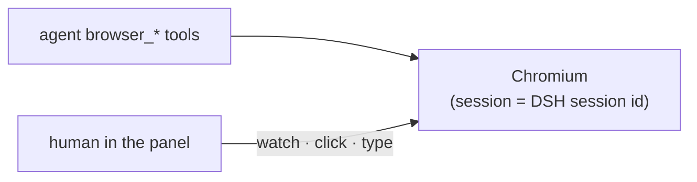
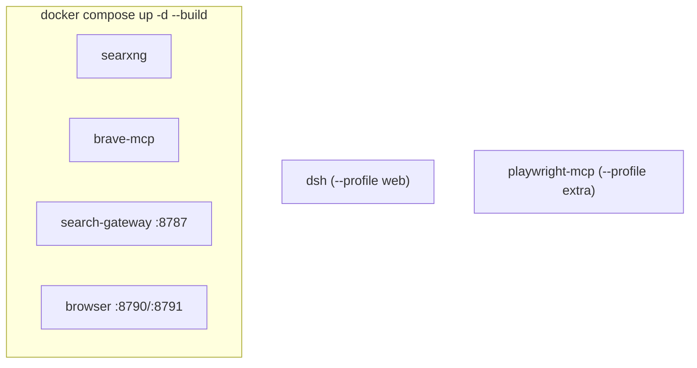

# dsh-browser

[](https://github.com/codeadeel/dsh-browser/actions/workflows/ci.yml)
[](LICENSE)
[](https://nodejs.org)
[](docker-compose.yml)

Give your DeepSeek Harness agent a real browser — and watch it work.

A live Chromium for every DSH session: the agent drives it, you watch it in a
panel inside the UI, and you can take over with your own mouse and keyboard at
any time. Backed by a ranked search gateway (SearXNG, Google CSE, Gemini, Brave,
Vertex, DuckDuckGo) with whole-web Google results.

<a href="docs/demo/dsh-browser-demo.mp4"></a>

## How it fits together



## What you get

- **Live panel** — every page the agent opens, as it happens; take over
  instantly (your clicks and keys go to the same tab). Resizable card, tabs
  strip, address bar, maximize mode.
- **Ranked search** — whole-web Google results via Gemini grounding; Brave,
  SearXNG, Vertex, DuckDuckGo reorderable; first provider that answers wins,
  the rest are fallback. Keys live in one settings page, never shown again.
- **One session, one browser** — the browser session id *is* the DSH session
  id, created on first use; isolated profile, cookies and tabs per session;
  idle sessions close themselves, and deleting a workspace closes the browser
  sessions attached to it.

17 agent tools: navigate, snapshot, click, type, press, scroll, tabs,
screenshot, search, wait_for, find, batch, console, network. CAPTCHA or
consent page? The agent pauses and asks — you finish it in the panel, by
design, never automated.

## Try it

```bash
git clone https://github.com/codeadeel/dsh-browser.git && cd dsh-browser
cp .env.example .env              # Gemini/Brave keys (SearXNG needs none)
docker compose up -d --build     # one command, whole backend

dsh --profile web --patch config/dsh-search.patch.yml --no-open --host 0.0.0.0 --port 3000
```

<details>
<summary><b>Install the panel plugin</b> (UI or CLI)</summary>

**From the DSH UI** — open the `?token=` URL DSH printed:

1. **Plugins** in the sidebar
2. **Add plugin**
3. paste `github:codeadeel/dsh-browser#path:panel` into the **package field**
   (leave **Registry** on the default npm registry — its custom address is for
   private registries, not plugin specs)
4. **Install → Enable now**

**From the CLI:**

```bash
dsh plugin --profile web add "github:codeadeel/dsh-browser#path:panel"
```



</details>

Click the **Browser** button, and in **Plugins → dsh-browser-panel** set your
provider order, save, and run **Test search**.

Then ask the agent: *"search for the DeepSeek R2 release date, open the top
result, and summarize it"* — and watch it happen in the panel.

## How a search works



- Gemini = whole-web Google grounding, AI Studio key, billing required.
- Brave = official Brave MCP service in compose; REST fallback with a key.
- SearXNG = free, self-hosted, no key. Vertex = site-scoped app search.
- One address for everything (`DSH_SEARCH_URL`, settable in the plugin page);
  the stack can live on another machine. Plain HTTP end to end.

## How the browser works



## Why it exists

- **Trust through visibility** — you see exactly what the agent is doing, no
  more blind tool calls.
- **Human in the loop, not in the way** — same browser for both drivers, no
  VNC, no extension, no screen-recording hacks.
- **Search that keeps up** — Gemini grounding gives current whole-web results;
  SearXNG and Brave cover privacy and cost.
- **No private registry, zero accounts** — first-party services build from
  source; SearXNG runs from its official image.

<details>
<summary><b>Full compose & repo layout</b></summary>



```text
panel/           what you see in DSH (panel UI, settings, host bridge)
src/search/      the ranked search gateway
src/browser/     Chromium sessions + the live viewer
docs/demo/       the 35s product demo + preview
docker-compose.yml + Dockerfile    the whole backend, one command
```

</details>

Docs: [`docs/walkthrough.md`](docs/walkthrough.md) — the 10-minute tour.
Architecture for contributors: [`docs/architecture.md`](docs/architecture.md).
MIT license.
