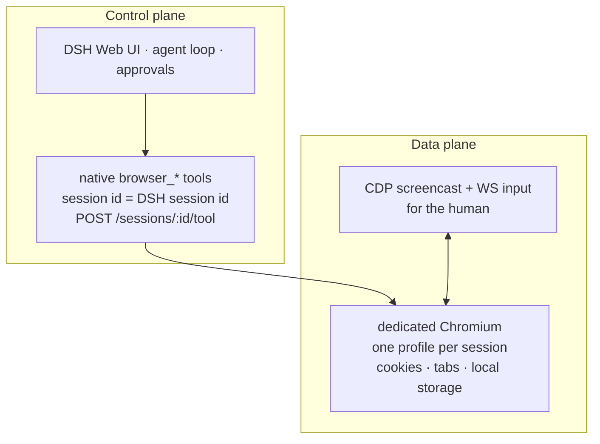
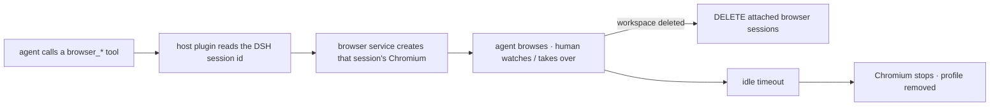
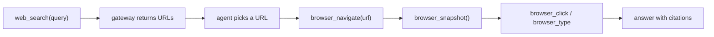
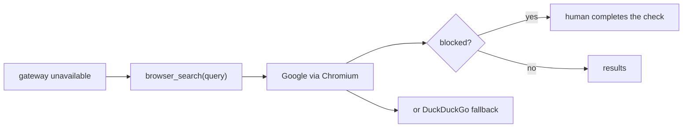
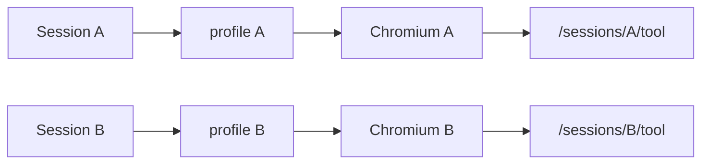
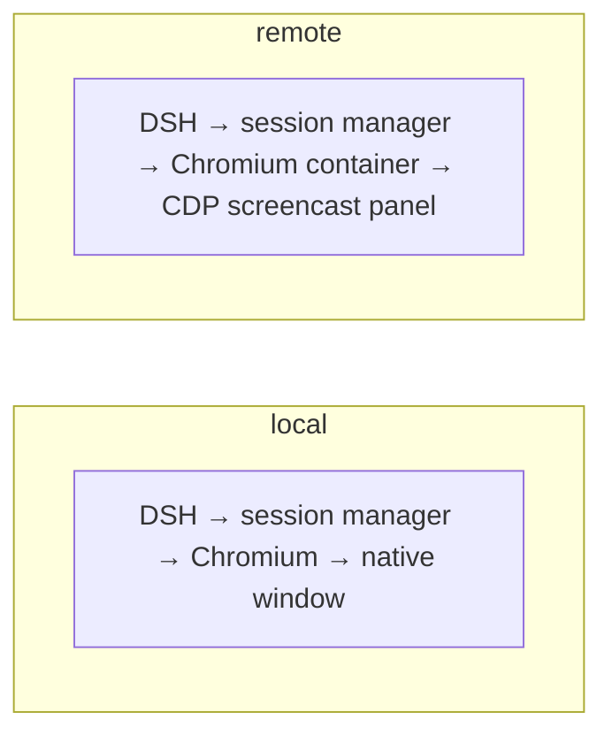

# Architecture

## Goal

Give a DSH agent a real Chromium browser that a human can watch and share, without a browser extension and without coupling the browser to a DSH plugin version.

## Control and data planes

The search gateway is a separate shared service. It is not part of Chromium.

## Components

### Search gateway

- Stateless MCP server exposing `web_search`.
- Ranked provider chain: SearXNG, Google CSE, Gemini, Brave, Vertex, DuckDuckGo.
- Returns URLs and snippets. Does not know about browser sessions.

### Browser session manager

- HTTP API: `POST /sessions`, `GET /sessions`, `DELETE /sessions/:id`, `POST /sessions/:id/tool`.
- Creates one Chromium per session, lazily: the first tool call for a DSH
  session id creates that session's Chromium.
- Tracks `lastActivityAt` and sweeps idle sessions after a configurable timeout.
- Watches `domain/changed`; deleting a workspace closes the browser sessions
  attached to it. DSH removes only the workspace registration and keeps the
  session logs, so the host plugin mirrors the workspace's `sessionIds`.

### Browser tools

- 17 native tools registered by the panel host plugin (navigate, snapshot,
  click, type, press, scroll, tabs, screenshot, search, wait_for, find, batch,
  console, network, ...).
- Puppeteer/CDP drives the dedicated Chromium; `browser_search` detects
  human-verification pages and reports `blocked: true`.

### DSH

- Connects to the search gateway as a generic MCP client.
- Loads `dsh-browser-panel`, whose host half registers the native `browser_*`
  tools and proxies `/dsh-browser/*` to the loopback services.
- Contains no Chromium code; can be upgraded independently.

## Session lifecycle

## Hybrid search flow

Fallback when the gateway is down:

## Isolation boundary

Isolation is the browser profile/process, not a tab group.

A tab group in one profile is not isolation because cookies and logins are shared.

## Local and remote deployment

The contracts stay the same. The viewer is a CDP screencast; no VNC layer is required.
